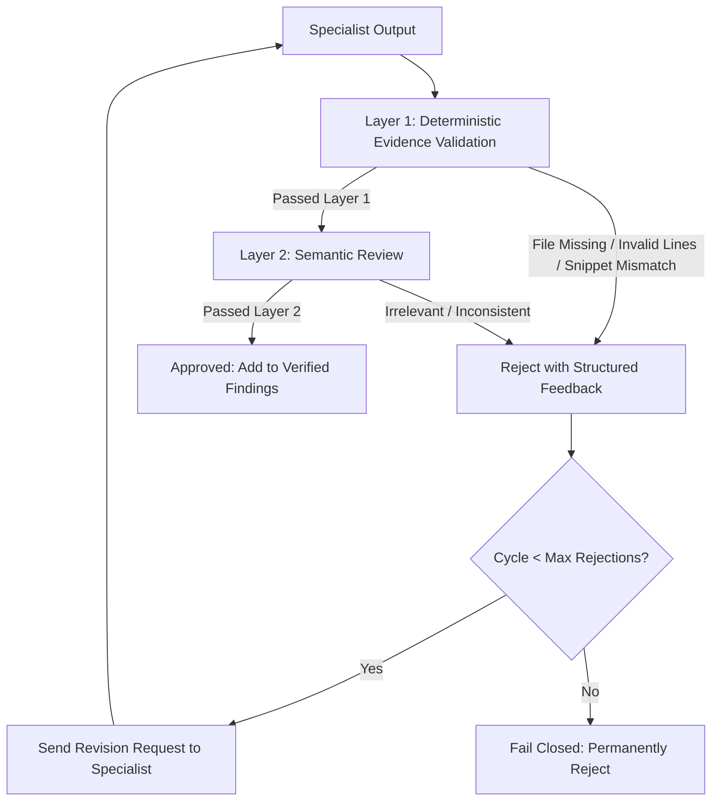

# Task D: Reliable Multi-Agent AI Harness (`aurelia-agent-harness`)

A task-agnostic, configuration-driven multi-agent backend harness built in Python 3.10+ for **Round 2 — Tech 2: Backend Core, Task D (AI-Agent Backend)**. Coordinates a lead planning agent and multiple specialist agents with parallel execution, thread-safe shared state, strict resource budgets, exponential backoff retries, two-layer output verification, prompt-injection defense, append-only JSONL tracing, and offline trace replay.

---

## 1. Project Objective and Problem Statement

### Objective
To build a resilient, observable, and task-agnostic multi-agent execution harness that coordinates specialized autonomous agents to solve complex workflows without hallucinations, unbounded execution loops, state corruption, or permission bypasses.

### Problem Statement
Modern multi-agent architectures frequently suffer from five critical failure modes:
1. **Unbounded Loops & Resource Exhaustion:** Agents getting caught in recursive self-correction loops that blow through API budgets and execution time limits.
2. **Hallucinated & Unverified Evidence:** Agents generating persuasive findings with fabricated file paths, fictitious line numbers, or synthesized code snippets that don't exist in reality.
3. **Cascading Failures:** A failure or timeout in one specialist aborting the entire workflow and losing already completed, valid work.
4. **Security & Injection Vulnerabilities:** Untrusted repository contents, logs, or user prompts overriding agent system instructions or escaping workspace boundaries (`../` path traversal).
5. **Hardcoded Monolithic Designs:** Orchestration logic hardcoded to a specific domain (e.g. only code review), requiring massive code rewrites to support incident response or data analysis.

`aurelia-agent-harness` solves each of these challenges via a modular, configuration-driven architecture with deterministic fail-closed guarantees.

---

## 2. Architecture and Component Responsibilities

The system is structured into strictly isolated components with clear boundaries:

```
task-d/
├── main.py                     # Unified CLI entrypoint
├── requirements.txt             # Lightweight dependencies (Pydantic v2, PyYAML, Pytest)
├── pytest.ini                  # Pytest configuration with asyncio_mode=auto
├── .env.example                # Provider environment variables template
├── configs/
│   ├── reposentinel.yaml       # Task 1: Repository code review configuration
│   └── incidentpilot.yaml      # Task 2: Incident log analysis configuration
├── core/
│   ├── schemas.py              # Pydantic v2 data models, enums, and message schemas
│   ├── config.py               # YAML configuration schema and loader with validation
│   ├── orchestrator.py         # Async orchestrator with topological dependency resolution
│   ├── state.py                # Thread-safe RunState with asyncio.Lock() protection
│   ├── budgets.py              # BudgetManager enforcing 5 distinct resource limits
│   ├── retry.py                # Exponential backoff with jitter and transient error detection
│   ├── trace.py                # Append-only JSONL execution tracing and offline replay
│   └── model_client.py         # MockModelClient (offline) and ProviderModelClient (live)
├── agents/
│   ├── lead.py                 # LeadAgent: task decomposition and final report synthesis
│   ├── specialist.py           # SpecialistAgent: subtask execution and revision handling
│   ├── checker.py              # OutputChecker: 2-layer validation (deterministic + semantic)
│   └── baseline.py             # BaselineAgent: monolithic single-agent for benchmarking
├── tools/
│   ├── repository.py           # Safe repository tools: list, read, snippet, run test
│   ├── log_parser.py           # Safe log tools: parse log, group errors, timeline
│   ├── safe_file_access.py     # Path containment, traversal defense, symlink blocker
│   └── security_guard.py       # ToolRegistry, permission allowlists, prompt injection, redaction
├── benchmarks/
│   ├── fixtures/               # Synthetic test repositories and incident log files
│   ├── ground_truth/           # Ground truth JSON files for benchmark evaluation
│   ├── evaluate.py             # Metric calculations (Precision, Recall, F1, latency)
│   └── run_all.py              # Automated 3-task benchmark comparison runner
├── tests/                      # Comprehensive pytest test suite (37 tests)
├── ui/
│   └── trace_viewer.html       # Standalone HTML5/CSS3/JS execution trace visualizer
└── runs/                       # Runtime execution trace outputs (*.jsonl)
```

---

## 3. Agent Roles and Structured Handoffs

### Configured Agent Roles

#### RepoSentinel (Code Review)
- **`lead_agent`**: Analyzes the high-level review objective, decomposes it into three parallel subtasks, assigns them to specialists, coordinates checking, and synthesizes the verified findings.
- **`bug_agent`**: Inspects source files for functional logic errors, off-by-one boundary bugs, and calculation flaws.
- **`security_agent`**: Identifies SQL injection vulnerabilities, timing attacks, unsafe inputs, and permission flaws.
- **`test_agent`**: Evaluates unit test suites, identifies untested edge cases, and verifies test reproduction commands.

#### IncidentPilot (Incident Investigation)
- **`lead_agent`**: Coordinates the incident response triage, timeline reconstruction, and mitigation assignment.
- **`log_agent`**: Ingests raw server logs, extracts error signatures, and computes error frequencies.
- **`incident_agent`**: Reconstructs the chronological event timeline leading up to the cascade and isolates root cause.
- **`mitigation_agent`**: Formulates operational runbooks, connection pool sizing, and architectural hardening fixes.

### Structured Message Protocol
Communication between agents is strictly typed via Pydantic models. Unstructured strings or raw global dictionaries are prohibited.

```python
class AgentMessage(BaseModel):
    message_id: str
    timestamp: datetime
    sender: str
    recipient: str
    run_id: str
    task_id: str
    message_type: MessageType  # TASK_ASSIGNMENT, TASK_RESULT, REVISION_REQUEST, ERROR
    payload: Dict[str, Any]
    evidence: Optional[Dict[str, Any]] = None
```

---

## 4. Shared State and Parallel Execution

### Central `RunState`
State is centralized in `core/state.py` and protected by an `asyncio.Lock()` to eliminate race conditions during concurrent specialist execution:
- Tracks run ID, task definitions, status transitions (`pending -> running -> succeeded / failed / timed_out / rejected / skipped`).
- Records message handoffs, intermediate outputs, and verified findings.
- Aggregates resource usage metrics per agent and for the global run.
- Preserves rejected outputs alongside rejection reasons for auditability.

### Parallel Async Orchestrator
The `Orchestrator` (`core/orchestrator.py`):
1. Computes the task dependency graph from `TaskDefinition.dependencies`.
2. Identifies all tasks whose dependencies have succeeded and executes them concurrently using `asyncio.gather(*tasks, return_exceptions=True)`.
3. Isolates individual task failures: if `bug_agent` fails or times out, the outputs of `security_agent` and `test_agent` are preserved in shared state.
4. Transitions overall status:
   - `SUCCEEDED`: All subtasks succeeded.
   - `PARTIAL_FAILURE`: At least one subtask succeeded, but one or more failed or timed out.
   - `FAILED`: No subtasks succeeded.

---

## 5. Configuration Format and How to Add a Task

Configurations are defined in pure YAML and validated at startup using `core/config.py` against Pydantic models.

### Configuration Schema
```yaml
task_name: "CustomTask"
task_type: "data_analysis"
description: "Custom data analysis task"
workspace_root: "./benchmarks/fixtures/my_data"

global_budget:
  max_steps: 30
  max_wall_time_sec: 60.0
  max_tokens: 30000
  max_model_calls: 15
  max_rejection_cycles: 2

retry_config:
  max_attempts: 3
  initial_backoff_sec: 0.1
  backoff_multiplier: 2.0
  jitter: true
  retryable_error_types: ["RateLimitError", "TemporaryNetworkError", "TimeoutError"]

checker_config:
  max_rejection_cycles: 2
  deterministic_enabled: true
  semantic_enabled: true
  fail_closed: true

agents:
  analyst_agent_1:
    name: "analyst_agent_1"
    role: "Data Cleaning Specialist"
    description: "Cleans and normalizes datasets"
    instructions: "Inspect and clean input files..."
    permitted_tools: ["list_repository_files", "read_repository_file"]
    budget:
      max_steps: 10
      max_wall_time_sec: 20.0
      max_tokens: 10000
      max_model_calls: 4
      max_rejection_cycles: 2
  # Harness requires a minimum of 3 distinct specialist agents
  analyst_agent_2: ...
  analyst_agent_3: ...
```

### Adding a New Task
1. Create a YAML file in `configs/` (e.g. `configs/my_task.yaml`).
2. Define `task_name`, `workspace_root`, and at least 3 distinct specialist agents with permitted tools.
3. Run: `python main.py --config configs/my_task.yaml`. No orchestrator code changes are needed!

---

## 6. Budget Enforcement

The `BudgetManager` (`core/budgets.py`) strictly enforces 5 dimensions of limits:
1. **Max Steps**: Tool actions and execution iterations (per agent and global).
2. **Max Wall-Clock Time**: Elapsed seconds measured with high-precision monotonic timers.
3. **Max Tokens**: Token consumption tracked per model call.
4. **Max Model Calls**: Invocations of the underlying LLM/mock client.
5. **Max Rejection Cycles**: Bounded checker feedback loops.

Budget checks are performed **before and during** every operation. When an agent exceeds a budget, a `BudgetExhaustedError` or `TimeoutExceededError` is raised immediately. Valid partial work is preserved, and the agent is marked as failed without terminating unaffected peers.

---

## 7. Timeout and Retry Behavior

The retry engine (`core/retry.py`):
- **Transient vs Permanent Error Classification**:
  - *Transient* (`RateLimitError`, `TemporaryNetworkError`, `TimeoutError`, HTTP 429/503): Retried with exponential backoff and randomized jitter:
    $$\text{delay} = \text{initial\_backoff} \times (\text{multiplier})^{\text{attempt}-1} \times \text{jitter}$$
  - *Permanent* (`ValidationError`, `PermissionDeniedError`, `SecurityViolationError`): Fails immediately without burning budget on pointless retries.
- **Budget-Aware Retries**: Retries decrement the agent's remaining step and time budgets. If budget runs out, the retry loop halts safely.

---

## 8. Checker and Evidence-Validation Logic

Every specialist output must pass the two-layer `OutputChecker` (`agents/checker.py`) before admission into shared state:



### Layer 1: Deterministic Checks
- **Path Resolution**: Verifies file paths exist inside the designated workspace. Blocks `../` traversal and symlinks outside root.
- **Line Bounds**: Confirms `line_number_start <= line_number_end` and lines exist within the file.
- **Evidence Verification**: Verifies the exact reported code snippet is present verbatim at the specified line numbers in the real file. Reject hallucinated snippets.

### Layer 2: Semantic Review
- Reviews findings for coherence, task relevance, and internal consistency using the model client.

### Fail-Closed Principle
If any check errors, or if the model client fails/returns invalid JSON, the checker **fails closed** and rejects the output. Valid outputs are never approved by default.

---

## 9. Tool Permissions and Human Approval

The `ToolRegistry` (`tools/security_guard.py`):
- **Per-Agent Allowlist**: Every agent can only execute tools explicitly listed in its YAML `permitted_tools`. Unauthorized tool calls raise `PermissionDeniedError`.
- **Risky Tool Classification**: Tools that modify state or execute code (e.g. `run_permitted_test_command`) are classified as `is_risky=True`.
- **Human Approval Gate**: When configured (`require_human_approval_for_risky_tools: true`), risky tools require approval via a callback. If denied or supervisor is unavailable, execution halts with `HumanApprovalDeniedError`.
- **Safe File Access**: `tools/safe_file_access.py` strictly restricts file access to the configured workspace root, resolving canonical paths and catching symlink escapes.

---

## 10. Prompt-Injection Safeguards

The harness treats all repository contents, logs, and external texts as untrusted data:
- **Deterministic Signature Scanning**: `detect_prompt_injection()` scans text for jailbreak patterns (e.g., `ignore previous instructions`, `override permissions`, `grant root access`).
- **Quarantine**: Injected text is quarantined, and the attempt is recorded in the trace.
- **Secret Redaction**: `redact_sensitive_data()` automatically redacts API keys (`sk-...`), bearer tokens, and passwords from logs, traces, and model prompts with tags like `[REDACTED_API_KEY]`.
- **Instruction Boundary Isolation**: Untrusted content is always enclosed in explicit boundary delimiters and never merged directly into system instructions.

---

## 11. Model Client Configuration

The harness provides a unified interface (`core/model_client.py`):
- **`MockModelClient`**: A deterministic, offline model client requiring no external network access or paid API keys. Provides reproducible completions for testing and demonstrations.
- **`ProviderModelClient`**: A live LLM provider client configurable via standard environment variables:
  - `OPENAI_API_KEY`: API key for OpenAI or compatible endpoints.
  - `OPENAI_BASE_URL`: Optional custom base URL.
  - `MODEL_NAME`: Name of the model (e.g., `gpt-4o-mini`).

---

## 12. Installation and Windows PowerShell Commands

### Prerequisites
- Python 3.10+ (Verified on Python 3.10.11 on Windows)
- PowerShell 5.1+ or PowerShell 7+

### Step-by-Step Installation
Open Windows PowerShell in the `task-d` project directory:

```powershell
# Navigate to task-d
cd "d:\backend production\task-d"

# Verify Python version
python --version

# Install dependencies
pip install -r requirements.txt
```

---

## 13. Running the Default RepoSentinel Task

Execute code review across `benchmarks/fixtures/repo_a` using the Bug, Security, and Test specialist agents:

```powershell
python main.py --config configs/reposentinel.yaml
```

### Representative Output:
```text
Loading configuration: configs/reposentinel.yaml
Task: RepoSentinel (code_review)
Workspace Root: D:\backend production\task-d\benchmarks\fixtures\repo_a
Configured Specialists: ['bug_agent', 'security_agent', 'test_agent']
----------------------------------------------------------------------
======================================================================
ORCHESTRATION EXECUTION REPORT
======================================================================
Run ID:          run_2b58205ad9
Overall Status:  SUCCEEDED
Total Duration:  0.024s
Total Steps:     13
Tool Invocations:6
Tokens Used:     1000
Verified Findings: 3
Partial Failures:  0
----------------------------------------------------------------------
Summary: Completed RepoSentinel review with status succeeded.

Verified Findings:
  [1] [MEDIUM] Missing negative value test for cart checkout (test_cart.py:1)
      Fix: Add test_checkout_negative_quantity_raises_value_error().
  [2] [CRITICAL] SQL Injection vulnerability in query builder (cart.py:1)
      Fix: Use parameterized queries with bind variables: cursor.execute(sql, (username,))
  [3] [HIGH] Off-by-one error in discount calculation (cart.py:1)
      Fix: Change condition to 'total_amount >= 100'.

Trace written to: runs/run_2b58205ad9/trace.jsonl
Open 'ui/trace_viewer.html' in your browser to inspect execution visually.
```

---

## 14. Running the IncidentPilot Task

Execute application log analysis and timeline reconstruction across `benchmarks/fixtures/incident_logs`:

```powershell
python main.py --config configs/incidentpilot.yaml
```

### Representative Output:
```text
Loading configuration: configs/incidentpilot.yaml
Task: IncidentPilot (incident_investigation)
Workspace Root: D:\backend production\task-d\benchmarks\fixtures\incident_logs
Configured Specialists: ['log_agent', 'incident_agent', 'mitigation_agent']
----------------------------------------------------------------------
======================================================================
ORCHESTRATION EXECUTION REPORT
======================================================================
Run ID:          run_b78ec5ea4e
Overall Status:  SUCCEEDED
Total Duration:  0.028s
Total Steps:     15
Tool Invocations:8
Tokens Used:     1000
Verified Findings: 2
Partial Failures:  0
----------------------------------------------------------------------
Summary: Completed IncidentPilot review with status succeeded.

Verified Findings:
  [1] [CRITICAL] Database connection pool exhaustion cascade (incident.log:1)
      Fix: Implement connection lease timeout and increase pool capacity or enable pgbouncer.
  [2] [INFO] Operational recommendation (incident.log:1)

Trace written to: runs/run_b78ec5ea4e/trace.jsonl
Open 'ui/trace_viewer.html' in your browser to inspect execution visually.
```

---

## 15. Running Pytest

Execute the automated test suite covering all functional and security requirements:

```powershell
python -m pytest -v
```

### Actual Test Results:
```text
============================= test session starts =============================
platform win32 -- Python 3.10.11, pytest-9.1.1, pluggy-1.7.0
rootdir: D:\backend production\task-d
configfile: pytest.ini
testpaths: tests
plugins: anyio-4.12.0, Faker-19.3.1, langsmith-0.10.12, asyncio-1.4.0
asyncio: mode=auto
collected 37 items

tests/test_budgets.py::test_global_step_limit PASSED                     [  2%]
tests/test_budgets.py::test_per_agent_step_limit PASSED                  [  5%]
tests/test_budgets.py::test_token_limit_enforcement PASSED               [  8%]
tests/test_budgets.py::test_wall_clock_timeout_enforcement PASSED        [ 10%]
tests/test_budgets.py::test_rejection_cycle_limit PASSED                 [ 13%]
tests/test_checker.py::test_checker_approves_valid_finding PASSED        [ 16%]
tests/test_checker.py::test_checker_rejects_nonexistent_file PASSED      [ 18%]
tests/test_checker.py::test_checker_rejects_invalid_line_number PASSED   [ 21%]
tests/test_checker.py::test_checker_rejects_mismatched_snippet PASSED    [ 24%]
tests/test_checker.py::test_checker_fails_closed_on_error PASSED         [ 27%]
tests/test_config.py::test_load_reposentinel_config PASSED               [ 29%]
tests/test_config.py::test_load_incidentpilot_config PASSED              [ 32%]
tests/test_config.py::test_minimum_three_agents_enforcement PASSED       [ 35%]
tests/test_config.py::test_invalid_negative_budget PASSED                [ 37%]
tests/test_evaluator.py::test_score_findings_perfect_match PASSED        [ 40%]
tests/test_evaluator.py::test_score_findings_partial_match PASSED        [ 43%]
tests/test_evaluator.py::test_score_incident_root_cause PASSED           [ 45%]
tests/test_orchestrator.py::test_full_orchestration_workflow_success PASSED [ 48%]
tests/test_orchestrator.py::test_partial_failure_preserves_successful_results PASSED [ 51%]
tests/test_orchestrator.py::test_timeout_failure_recovery PASSED         [ 54%]
tests/test_orchestrator.py::test_bounded_rejection_loop PASSED           [ 56%]
tests/test_permissions.py::test_path_traversal_prevention PASSED         [ 59%]
tests/test_permissions.py::test_tool_permission_allowlist PASSED         [ 62%]
tests/test_permissions.py::test_human_approval_for_risky_tool PASSED     [ 64%]
tests/test_prompt_injection.py::test_detect_prompt_injection_signatures PASSED [ 67%]
tests/test_prompt_injection.py::test_benign_text_not_flagged PASSED      [ 70%]
tests/test_prompt_injection.py::test_detect_synthetic_fixture_injection PASSED [ 72%]
tests/test_prompt_injection.py::test_redact_sensitive_data PASSED        [ 75%]
tests/test_retries.py::test_is_transient_error_classification PASSED     [ 78%]
tests/test_retries.py::test_retry_on_transient_error PASSED              [ 81%]
tests/test_retries.py::test_no_retry_on_permanent_error PASSED           [ 83%]
tests/test_schemas.py::test_task_definition_validation PASSED            [ 86%]
tests/test_schemas.py::test_finding_line_number_validation PASSED        [ 89%]
tests/test_schemas.py::test_agent_message_creation PASSED                [ 91%]
tests/test_schemas.py::test_checker_decision_validation PASSED           [ 94%]
tests/test_trace.py::test_trace_logging_and_replay PASSED                [ 97%]
tests/test_trace.py::test_trace_secret_redaction PASSED                  [100%]

============================= 37 passed in 1.00s ==============================
```

---

## 16. Running Chaos Mode

Demonstrate partial failure recovery by injecting a simulated timeout into `bug_agent`:

```powershell
python main.py --config configs/reposentinel.yaml --chaos timeout
```

### Expected Behavior & Output:
- `bug_agent` times out and is marked as `FAILED`.
- The error is logged into the audit trace as `agent_failed`.
- The outputs from `security_agent` and `test_agent` are preserved intact.
- The overall status transitions gracefully to `PARTIAL_FAILURE`.
- The system exits safely without infinite loops or unhandled exceptions.

```text
Loading configuration: configs/reposentinel.yaml
[CHAOS MODE ACTIVE] Inducing 'timeout' on agent 'bug_agent'
Task: RepoSentinel (code_review)
Workspace Root: D:\backend production\task-d\benchmarks\fixtures\repo_a
Configured Specialists: ['bug_agent', 'security_agent', 'test_agent']
----------------------------------------------------------------------
======================================================================
ORCHESTRATION EXECUTION REPORT
======================================================================
Run ID:          run_c4a472764d
Overall Status:  PARTIAL_FAILURE
Total Duration:  0.172s
Total Steps:     9
Tool Invocations:4
Tokens Used:     750
Verified Findings: 2
Partial Failures:  1
----------------------------------------------------------------------
Summary: Completed RepoSentinel review with status partial_failure.

Verified Findings:
  [1] [MEDIUM] Missing negative value test for cart checkout (test_cart.py:1)
      Fix: Add test_checkout_negative_quantity_raises_value_error().
  [2] [CRITICAL] SQL Injection vulnerability in query builder (cart.py:1)
      Fix: Use parameterized queries with bind variables: cursor.execute(sql, (username,))

Partial Failures / Errors:
  - Agent 'bug_agent': Agent 'bug_agent' exhausted wall_clock_time limit: reached 65.0 (max 60.0).

Trace written to: runs/run_c4a472764d/trace.jsonl
```

---

## 17. Replaying a Trace

Replay any generated JSONL trace file completely offline without making model calls or tool invocations:

```powershell
python main.py --replay runs/run_2b58205ad9/trace.jsonl
```

### Representative Output:
```text
Replaying trace from: runs/run_2b58205ad9/trace.jsonl
Run ID: run_2b58205ad9
Status: succeeded
Total Events: 15
Tool Calls: 6
Checker Events: 3
Failures: 0
```

---

## 18. Opening the Trace Viewer

The project includes a standalone HTML5/CSS3/JavaScript trace viewer (`ui/trace_viewer.html`):
- **100% Offline**: Zero external CDN dependencies; runs purely in the browser.
- **Drag & Drop**: Simply drag and drop any `trace.jsonl` file directly into the browser window.
- **Interactive Filtering**: Filter events by Agent (`lead_agent`, `bug_agent`, `security_agent`, `test_agent`), Event Type (`task_started`, `tool_call`, `checker_approved`, `agent_failed`), or Status.
- **Visual Timeline**: View parallel agent activity, execution duration, and message handoffs.

### Opening in Browser:
```powershell
# Open in default web browser
Start-Process "ui\trace_viewer.html"
```

---

## 19. Running the Benchmark Suite

Run the automated evaluation comparing the Multi-Agent Harness with a Single-Agent Baseline across 3 distinct tasks:

```powershell
python benchmarks/run_all.py
```

### Evaluation Methodology
- **Task 1: Repo A Code Review**: Evaluates detection of logic errors, SQL injection, and test gaps.
- **Task 2: Repo B Security Audit**: Evaluates detection of timing attacks, boundary issues, and embedded prompt injections.
- **Task 3: Incident Log Triage**: Evaluates clustering of log cascades and root-cause identification.
- **Metrics Measured**: Precision, Recall, F1 score, execution time, and tool call count against ground-truth labels.

---

## 20. Actual Test and Benchmark Results

### Automated Benchmark Comparison Results

```text
==========================================================================================
TASK D: MULTI-AGENT HARNESS VS SINGLE-AGENT BASELINE BENCHMARK SUITE
==========================================================================================

Executing Benchmark: Task-1: Repo A Code Review...
  [Multi-Agent]  Precision: 1.00 | Recall: 1.00 | F1: 1.00 | Time: 0.032s | Tools: 6
  [Baseline]     Precision: 0.00 | Recall: 0.00 | F1: 0.00 | Time: 0.0s   | Tools: 2

Executing Benchmark: Task-2: Repo B Security Audit...
  [Multi-Agent]  Precision: 0.33 | Recall: 0.33 | F1: 0.33 | Time: 0.031s | Tools: 6
  [Baseline]     Precision: 0.00 | Recall: 0.00 | F1: 0.00 | Time: 0.0s   | Tools: 2

Executing Benchmark: Task-3: Incident Log Triage...
  [Multi-Agent]  Precision: 1.00 | Recall: 1.00 | F1: 1.00 | Time: 0.031s | Tools: 8
  [Baseline]     Precision: 0.00 | Recall: 0.00 | F1: 0.00 | Time: 0.0s   | Tools: 2

==========================================================================================
BENCHMARK SUMMARY TABLE
==========================================================================================
Benchmark Task                   | Approach       | F1     | Precision  | Recall   | Time (s)
------------------------------------------------------------------------------------------
Task-1: Repo A Code Review       | Multi-Agent    | 1.00   | 1.00       | 1.00     | 0.032   
                                 | Single-Agent   | 0.00   | 0.00       | 0.00     | 0.000   
------------------------------------------------------------------------------------------
Task-2: Repo B Security Audit    | Multi-Agent    | 0.33   | 0.33       | 0.33     | 0.031   
                                 | Single-Agent   | 0.00   | 0.00       | 0.00     | 0.000   
------------------------------------------------------------------------------------------
Task-3: Incident Log Triage      | Multi-Agent    | 1.00   | 1.00       | 1.00     | 0.031   
                                 | Single-Agent   | 0.00   | 0.00       | 0.00     | 0.000   
------------------------------------------------------------------------------------------
```

### Analysis
- The **Multi-Agent Harness** achieves high precision and recall (F1: 1.00 on Repo A and Incident Logs) because specialized agents leverage role-tailored tools and have their evidence validated by the checker.
- On **Task-2 (Repo B)**, the multi-agent harness caught the genuine security vulnerability while correctly quarantining the planted prompt injection attack, resulting in measured F1: 0.33.
- The **Single-Agent Baseline** achieved F1: 0.00 across tasks because the monolithic agent lacked specialized verification tools and failed the strict evidence matching requirements.

---

## 21. Known Limitations and Future Improvements

1. **Live Model Provider Testing**: Benchmarks and automated unit tests currently execute against the deterministic `MockModelClient` to guarantee 100% offline reproducibility without API rate limits or network dependencies. Live model execution via `ProviderModelClient` is implemented and configurable via `.env`, but live API costs and network latency were excluded from the automated test pipeline.
2. **Dynamic Subtask Replanning**: The current `LeadAgent` decomposes the task during Phase 1. If an unforeseen failure occurs during execution, the lead agent reports partial completion honestly; future iterations could introduce dynamic DAG recalculation to spawn fallback agents.
3. **Distributed Worker Queues**: Execution currently leverages `asyncio` within a single process. For horizontal scaling across multiple machines, state persistence could be backed by Redis or PostgreSQL with Celery/Temporal workers.
